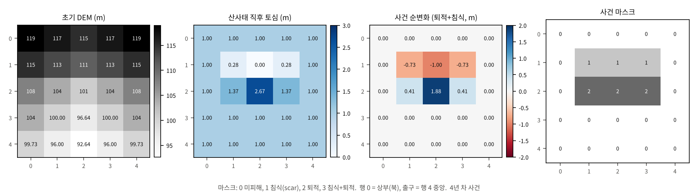
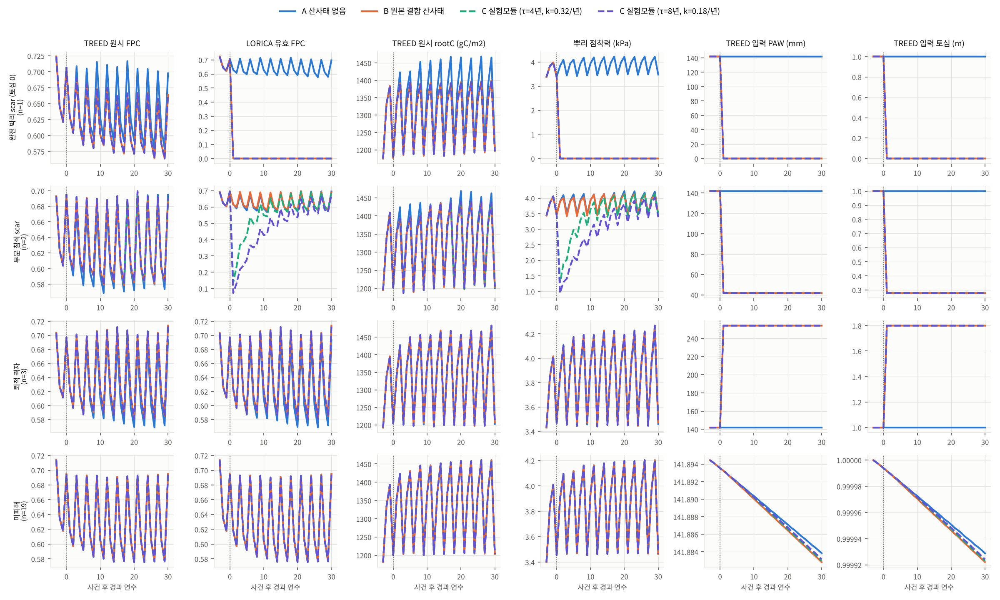
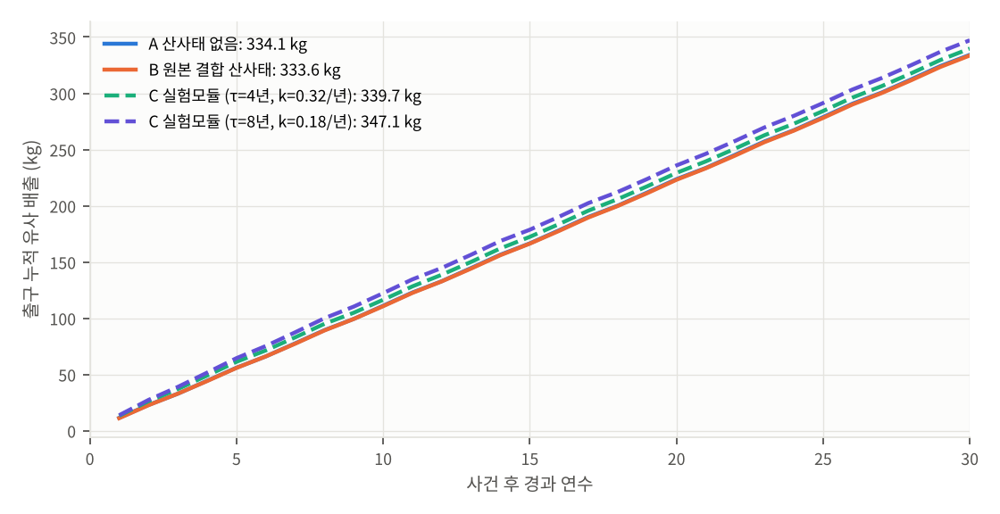

# 고운사 TREED–LORICA v1.6: 실제 산사태 사건 직후와 이후 30년의 식생 반응 검증

작성일 2026-11-16. 합성 5×5 개방 사면(10 m 격자) 시험이며 고운사 현장 자료로 보정한 결과가 아니다.

## 0. 요약

1. 원래 LORICA 산사태 루틴(`calculate_critical_rain()`, `calculate_slide_new()`)이 4년 차에 실제로 3개 격자에서 붕괴를 일으켰다. 중앙 격자는 1 m 토양이 모두 제거되어 기반암이 드러났고, 양옆 2개 격자는 0.73 m가 침식되어 0.28 m가 남았다. 바로 아래 3개 격자에 0.41, 1.88, 0.41 m가 퇴적되었다. 나머지 19개 격자는 영향이 없었다. 사건 단계 질량수지 오차는 0, 34년 연간 질량수지 최대 오차는 1.7e-15였다.
2. 사건 해의 TREED 값(원시 FPC, rootC, 뿌리 점착력)은 산사태 **전** 상태다. 산사태 대조군 A와 산사태 B의 사건 해 TREED 출력은 비트 단위로 같았다. 산사태에 쓰인 뿌리 점착력은 같은 해 연초 TREED 값(3.38~3.50 kPa)이다.
3. 다음 해 TREED는 바뀐 DEM, 토심, PAW를 정확히 받는다(전달 오차 ≤ 4.8e-7 m). 그러나 원본 결합에서 일어난 일은 다음과 같다.
   - **부분 침식 격자(토심 0.28 m)**: 유효 FPC와 뿌리 점착력이 바로 다음 해에 사건 전 수준으로 돌아갔다(5년 차 3.96 kPa, A와 동일). TREED에 사망 과정이 없고, LORICA의 유효값 차단은 토심이 0일 때만 걸리기 때문이다.
   - **완전 박리 격자(토심 0)**: 유효 FPC와 뿌리 점착력은 30년 내내 0이다. 반면 TREED 원시 FPC는 0.57~0.69, 수고 H는 17.5~19.8 m로 유지되었다. 토양생성 과정이 꺼져 있어 회복 경로도 없다.
   - **퇴적 격자(1.88 m 매몰 포함)**: 매몰 피해 없이 다음 해 피복과 점착력이 사건 전과 같다.
   - **TREED 원시 반응**: 사건 다음 해(습윤년)에는 A와 비트 단위로 같았고, 첫 건조년부터 차이가 생겼다. 완전 박리 격자(PAW 142→0 mm)에서 30년 평균 원시 FPC −3.6%, LAI −6.8%, rootC −2.7%로 잡음 수준을 넘는 감소가 나타났다. 부분 침식 격자(PAW 142→42 mm)는 +0.5~+1.5%로 부호가 반대이며 잡음 수준이다.
4. `traits_restart.jld2`에는 형질 9개(H, a_ll, C_leaf, seasonality, r_s_r, 최적 온도 3개, 최적 강수)만 있고, 교란 여부나 연령, 사망량을 기록하는 필드는 없다. A와 B의 재시작 파일은 5년 차까지 SHA-256이 같았고 6년 차에 처음 달라졌다.
5. 원본의 한계가 드러난 뒤에 별도 이름의 실험 모듈(C, 기본값 꺼짐)을 적용했다. 이 모듈은 LORICA 쪽 유효 피복과 유효 뿌리탄소에만 작용하고 TREED와 재시작 파일은 건드리지 않는다. 부분 침식 격자의 다음 해 뿌리 점착력은 1.29 kPa(τ=4년) 또는 0.95 kPa(τ=8년)였다. τ=4년 시나리오는 약 20년 뒤 B와 비슷해졌고, τ=8년 시나리오는 30년 차에도 B보다 조금 낮았다(3.39 대 3.46 kPa). 출구 누적 유사 배출은 B 대비 +6.2 kg(+1.9%), +13.5 kg(+4.0%)이었다. 모듈을 켜고 산사태가 없는 C_null은 A를 정확히 재현했다. **C의 회복 속도는 문헌 범위에서 고른 시나리오이며 검증값이 아니다.**
6. 재현성: v1.6 계측 훅을 넣은 상태로 v1.5 30년 시험(β=2, 13년)을 다시 실행한 결과, v1.5 산출물의 연간 표 13행과 격자 래스터 7종이 모두 비트 단위로 같았다. 계측 훅이 물리를 바꾸지 않았고, β=2 실행은 별도 러너에서도 결정론적으로 반복된다. 따라서 v1.5에서 13년 차에 나타난 β0/β2 차이는 적어도 β=2 쪽의 실행 간 비결정성 때문은 아니다(β=0 반복은 이번에 하지 않음).

## 1. GitHub 위치

| 항목 | 링크 |
|---|---|
| 작업 브랜치 (기존 v1.5 브랜치는 변경하지 않음) | [lorica-treed-v1.6-landslide-recovery](https://github.com/physical-geogrpahy-forever/gounsa-windows-build/tree/lorica-treed-v1.6-landslide-recovery) |
| 결과 브랜치 (Actions가 직접 커밋) | [lorica-treed-v1.6-landslide-recovery-results](https://github.com/physical-geogrpahy-forever/gounsa-windows-build/tree/lorica-treed-v1.6-landslide-recovery-results) |
| 커밋 1: 계측 훅, 실행기, 탐색 | [039183c](https://github.com/physical-geogrpahy-forever/gounsa-windows-build/commit/039183c047e02d27a08b338d2842d19aabac6ea4) |
| 커밋 2: 오목 급애 탐색, 유발강도 분리, 덤프, 검증기 | [fc0d6f1](https://github.com/physical-geogrpahy-forever/gounsa-windows-build/commit/fc0d6f1374ab17efa75f3fcd322c598c3d0d8f60) |
| 커밋 3: A/B 34년 + v1.5 회귀 실행 | [cb9c098](https://github.com/physical-geogrpahy-forever/gounsa-windows-build/commit/cb9c0988eef9996410fd4781314fbe0c71ef4bff) |
| 커밋 4: 실험 모듈 C | [a4f28a4](https://github.com/physical-geogrpahy-forever/gounsa-windows-build/commit/a4f28a436aba57e092e52bc4d895e73b52beb45c) |
| 탐색 1 (246회, 실패 0) | [#43789221109](https://github.com/physical-geogrpahy-forever/gounsa-windows-build/actions/runs/43789221109) |
| 탐색 2 (오목 급애, 42회, 실패 0) | [#43790023979](https://github.com/physical-geogrpahy-forever/gounsa-windows-build/actions/runs/43790023979) |
| A/B/R 실행 | [#43790582202](https://github.com/physical-geogrpahy-forever/gounsa-windows-build/actions/runs/43790582202) |
| C 실행 + A/B/R 재시작 재덤프 | [#43795357866](https://github.com/physical-geogrpahy-forever/gounsa-windows-build/actions/runs/43795357866) |

**#43790582202의 세 작업이 '실패'로 표시된 이유**: 모델 실행 단계는 세 작업 모두 성공했다. 실패한 단계는 실행 뒤 재시작 파일을 CSV로 덤프하는 `dump_treed_states.jl` 하나다. 최적값 형질에 길이 1의 시간 축이 남아 있어서 생긴 오류였다. 커밋 4에서 고쳤고, #43795357866의 `dump-ab` 작업이 같은 재시작 파일을 다시 덤프했다(성공). 결과 해석에는 영향이 없다.

결과 브랜치 구조: `runs/<run_id>_<tag>/lorica-v16-<조건>/run/` 아래에 `annual_state.csv`, `cell_timeseries.csv`, `slide_stage_ledger.csv`, `soil_layers.csv`, `event_mask_code.asc`, `year_XX/`(원시와 유효 래스터, 산사태 전후 래스터(`pre_slide/`, `post_slide/`), `traits_restart.jld2`, TREED NetCDF)가 있다. GitHub Actions 아티팩트도 같은 내용으로 남아 있다.

## 2. 코드 근거 감사

줄 번호는 `v0.5` 번들에 v1.1~v1.3 패치와 v1.6 계측 훅을 적용한 A/B 빌드 기준이다. TREED 파일은 번들 원본 기준이다.

### 2.1 원본 TREED와 고운사 결합 확장의 경계

| 위치 | 내용 | 판정 |
|---|---|---|
| `TREED/src/TREEDlocalstep.jl` 20–58 | `create_TREED_local_climate_input()`. `habitable`은 기온과 지형의 유한성만 본다(54–55). `soildepth_m ≤ 0`을 서식 불가로 처리하지 않는다. | 고운사 측 로컬 확장 |
| 같은 파일 72–84 | 재시작 파일이 없으면 초기 형질, 있으면 `traits_end`를 읽는다. 최적화, 진화, 생태 단계 뒤 `@save ... traits_end`(84). | 저장 대상은 형질뿐 |
| `TREED_model_functions.jl` 27–39 | `struct traits` 필드 9개. 개체수, 사망, 연령, 교란 기록 없음. | 원본 구조 |
| 같은 파일 467–468 | 생산 가능한 형질 조합이 없으면 `H=0`, 다른 형질은 보존(피난처 해석 주석). | 산사태 사망 모듈이 아님 |
| `TREED_physiological_functions.jl` 195–198 | PAW를 `soil_water_coupling_strength × root_access × PAW / paw_release_days`로 하루 공급량에 더하고, `Esupply = min(Emax=5, 강수 + 이 값)`. | 고운사 결합 확장. 토심이 TREED에 닿는 **유일한** 경로 |
| 같은 파일 전체 | `soildepth_m`은 env에 실려 오지만 생리 계산에서 쓰이지 않는다. | 토심 자체는 TREED에 직접 영향 없음 |

PAW 142 mm, 방출일수 365일, r_s_r=1(root_access 0.5)이면 PAW 항은 하루 약 0.19 mm다. 연 600~900 mm의 강수(하루 1.6~2.5 mm)에 비해 작다. 이 때문에 토양이 모두 사라진 격자에서도 TREED는 강수만으로 수관을 유지한다.

### 2.2 LORICA 연간 순서와 산사태

| 위치 | 내용 |
|---|---|
| `LORICA_main.cs` 7185 | `run_treed_coupling()` (연초, 그해 기상) |
| 7222 | `calculate_water_ero_sed_daily()` |
| 7327, 7330 | v1.6 읽기 전용 계측 `gounsa_capture_landslide_stage("pre_slide"/"post_slide")` |
| 7328 | `calculate_slide_new()` |
| `geomorph.cs` 2271 이후, 2424 | `calculate_critical_rain()`. 무조건 안정 판정 시 `crrain = nodata` |
| 2648 | 개시 조건 `crrain ≥ 0 && 사건강도 > crrain` |
| 2680 | 붕괴 깊이 `(ρsat/1000) × cosθ × (tanθ − 0.7) / Cf`, 토심으로 상한 |
| 2723, 2749 | 이동 물질은 경사 tan > 0.7(35°)인 하류 이웃으로만 전달, 그 외에는 퇴적 |
| 2834 | 실제 침식이 있는 경우에만 개시 격자로 계수 |
| `treed_coupling.cs` 296 | PAW = 층별 Saxton형 (θ33 − θ1500) × 층두께 합 |
| 같은 파일 409 이후, 496–508 | `zero_coupling`: 연초 토심 ≤ 1e-6 m일 때만 유효 FPC와 유효 rootC를 0으로 차단. 그 외에는 원시값 그대로 |

결론: 사건 해의 피해는 **다음 해 TREED 호출 때** 토심과 PAW로만 전달된다. 유효값 차단은 토심 0인 격자에만 작동한다.

### 2.3 v1.6에서 추가한 것 (모두 별도 파일, 기존 파일 비변경)

- `lorica_treed/v1.6/instrument_landslide_snapshots.py`: 산사태 직전과 직후 상태를 복제하는 읽기 전용 훅. 물리 변수에 쓰지 않는다. R 회귀가 비트 단위로 같았던 것이 그 증거다.
- `lorica_treed/v1.6/ci/LoricaTreedLandslideRecovery.cs`: v1.1 실행기의 함수를 그대로 복사하고 탐색 함수와 본실험 함수를 덧붙였다.
- `lorica_treed/v1.6/apply_experimental_landslide_recovery_module.py`: 조건 C 전용 실험 모듈. 설정 키 `gounsa_experimental_landslide_recovery=on`일 때만 작동한다.
- `lorica_treed/v1.6/dump_treed_states.jl`, `verify_landslide_recovery.py`: 읽기 전용 덤프와 독립 검증.

v1.1 공식 패치, v1.2 배출 계측, v1.3 하류 누적 `+=` 수정은 그대로 적용했다. 산사태 안정식, 임계강우식, 수류침식식은 바꾸지 않았다.

## 3. 시험 설계

### 3.1 산사태가 일부 격자에서만 나는 개방 사면 찾기 (탐색 1, 2)

v1.5 4년 차 실제 뿌리 점착력 지도(평균 3.45 kPa)를 넣고, 원래 `calc_and_write_ls_rasters()`와 `calculate_slide_new()`로 후보 지형을 직접 계산했다.

- 경사 38° 이하: 25개 격자 모두 무조건 안정.
- 40~50°: 임계강우가 유한하지만 0.0005~0.0024 m/d(6시간 0.1~0.6 mm에 해당)에 불과하다. 6시간 60, 90, 120, 150, 200, 300 mm 어느 경우에도 결과가 같았다. **이 설정에서 개시 여부는 강우량이 아니라 "무조건 안정" 판정, 즉 경사와 점착력과 토심이 결정한다.**
- 40°에서는 뿌리 점착력 3.38 kPa인 격자만 붕괴하고 3.45 kPa인 이웃은 안정했다. 2% 차이로 결과가 갈리는 경계 조건이라 본실험에 쓰지 않았다.
- 채택: `hollow_row1to2:36:42:46`. 기존 개방 사면 `z = 115 − 4r + 2|c−2|`에서 1행과 2행 사이 낙차만 열별로 10 × tan(36°, 42°, 46°, 42°, 36°)로 바꿨다. 뿌리 점착력 ×0.9, ×1.0, ×1.1 모두에서 개시 3개가 유지되었고, 사건 전 유발강도 0.1 mm/6h에서는 모두 0이었다(최소 임계 0.00097 m/d, 2.4배 여유).

### 3.2 강우와 사건 시점

일강우는 v1.5와 같다. 매년 1월 1일에 60 mm/6시간 하루, 나머지는 균등 배분이고, 연 강수 730/900/600 mm와 기온 10/11/12°C가 3년 주기로 반복된다. 모든 조건에서 같다. 사건 시점은 LORICA 산사태 루틴의 유발강도 입력(`landslide_event_rainfall_mm`)으로만 정했다. 1~3년 차는 0.1 mm/6h(모든 임계 미만), 4년 차부터는 60 mm/6h다. 3.1의 결과대로 유발강도는 사실상 "개시 판정을 할지 말지"의 스위치다. 이것은 실험 설계상의 선택이며 현장 강우 기록이 아니다.

### 3.3 조건

| 조건 | 설명 |
|---|---|
| A_no_landslide | 산사태 루틴 비활성. 나머지 동일 |
| B_landslide_original | 원래 산사태 루틴, 원래 결합(`zero_coupling`), TREED 수정 없음 |
| C (τ=4년, k=0.32/년) | B + 실험 모듈 |
| C (τ=8년, k=0.18/년) | B + 실험 모듈 |
| C_null | 실험 모듈을 켜되 산사태 비활성. A와 같아야 함 |
| R | v1.5 30년 시험 함수를 β=2로 13년 재실행 (계측 훅 포함) |

공통: 34년, 사건 4년 차, β=2(감쇠 실험값, 고운사 보정값 아님), K=1e-4, `fixed_original`, `soil_water_coupling_strength=1.0`, 시드 20261113, Hales(2009) 목표 기반 고정 점착력 보정 후 v1.5와 같은 배율 0.447. 토양생성, 풍화, 생물교란, creep는 v1.5와 같이 꺼져 있다.

## 4. 결과

### 4.1 사건 직전과 직후 (4년 차, B)

| 격자 (행,열) | 유형 | 직전 토심 (m) | 직후 토심 (m) | 침식 (m) | 퇴적 (m) | 임계강우 (m/d) | 사용된 뿌리 점착력 (kPa) | 직전 유효 FPC | 직후 PAW (mm) |
|---|---|---|---|---|---|---|---|---|---|
| (1,2) | 완전 박리 | 1.000 | 0.000 | 1.000 | 0 | 0.00115 | 3.385 | 0.707 | 0 |
| (1,1) | 부분 침식 | 1.000 | 0.278 | 0.732 | 0 | 0.00252 | 3.450 | 0.718 | 41.7 |
| (1,3) | 부분 침식 | 1.000 | 0.279 | 0.730 | 0 | 0.00253 | 3.466 | 0.672 | 41.9 |
| (2,1) | 퇴적 | 1.000 | 1.367 | 0 | 0.410 | 무조건 안정 | 3.502 | 0.694 | 192.9 |
| (2,2) | 퇴적 | 1.000 | 2.665 | 0 | 1.876 | 무조건 안정 | 3.495 | 0.689 | 376.5 |
| (2,3) | 퇴적 | 1.000 | 1.366 | 0 | 0.409 | 무조건 안정 | 3.398 | 0.708 | 192.8 |

사건 단계 질량: 산사태 전후 토양 질량 4,014,755.504 kg으로 같고, 잔류 운반 질량은 0이다. 모든 물질이 영역 안에 퇴적되었다. 직전의 운반 배열에 있던 30.3 kg은 그해 물침식의 경계 배출분이고, 이미 `treed_water_sediment_export_kg`에 계산되어 있다. 5년 차 이후 재붕괴는 없었다(부분 침식 격자는 경사가 낮아지고 토심이 얇아져 `Cf`가 커졌다).

### 4.2 시간 정합

| 검사 | 결과 |
|---|---|
| 1~3년 차 A와 B 격자값 | 차이 0 |
| 4년 차 TREED 원시값과 물침식, A 대 B | 차이 0 (TREED가 산사태보다 먼저 실행) |
| B의 산사태 직전 토심 = A의 4년 차 연말 토심 | 차이 0 |
| 재시작 SHA-256 | 5년 차까지 동일, 6년 차에 처음 달라짐 |
| 5년 차 TREED 입력 | 토심 차이 최대 1.665 m, PAW 차이 최대 234.6 mm |
| 5년 차 TREED 원시 FPC와 rootC | A와 B 동일(습윤년 900 mm라 PAW 항이 수분 제한을 바꾸지 않은 것으로 보임) |

### 4.3 경과 연수별 그룹 평균 (사건 해 = 0)

유효 FPC

| 그룹 | 조건 | 0 | 1 | 2 | 3 | 5 | 10 | 20 | 30 |
|---|---|---|---|---|---|---|---|---|---|
| 부분 침식 (n=2) | A | 0.695 | 0.614 | 0.591 | 0.674 | 0.578 | 0.591 | 0.572 | 0.695 |
| | B | 0.695 | 0.614 | 0.599 | 0.692 | 0.595 | 0.598 | 0.582 | 0.689 |
| | C τ4 | 0.695 | 0.136 | 0.236 | 0.365 | 0.425 | 0.549 | 0.579 | 0.689 |
| | C τ8 | 0.695 | 0.072 | 0.133 | 0.216 | 0.277 | 0.427 | 0.537 | 0.674 |
| 완전 박리 (n=1) | A | 0.707 | 0.629 | 0.608 | 0.709 | 0.598 | 0.627 | 0.592 | 0.697 |
| | B, C | 0.707 | 0 | 0 | 0 | 0 | 0 | 0 | 0 |
| 퇴적 (n=3) | A | 0.697 | 0.624 | 0.600 | 0.695 | 0.597 | 0.610 | 0.569 | 0.693 |
| | B, C | 0.697 | 0.624 | 0.597 | 0.701 | 0.587 | 0.621 | 0.581 | 0.714 |

뿌리 점착력 (kPa)

| 그룹 | 조건 | 0 | 1 | 2 | 3 | 5 | 10 | 20 | 30 |
|---|---|---|---|---|---|---|---|---|---|
| 부분 침식 | A | 3.458 | 3.894 | 4.099 | 3.502 | 4.122 | 3.928 | 4.226 | 3.455 |
| | B | 3.458 | 3.894 | 4.007 | 3.416 | 4.019 | 3.941 | 4.133 | 3.464 |
| | C τ4 | 3.458 | 1.287 | 1.885 | 2.027 | 2.986 | 3.641 | 4.109 | 3.464 |
| | C τ8 | 3.458 | 0.947 | 1.295 | 1.410 | 2.106 | 2.909 | 3.817 | 3.389 |
| 완전 박리 | A | 3.385 | 3.836 | 4.095 | 3.439 | 4.103 | 3.944 | 4.220 | 3.478 |
| | B, C | 3.385 | 0 | 0 | 0 | 0 | 0 | 0 | 0 |

완전 박리 격자의 TREED **원시** FPC는 B에서도 0.57~0.69를 유지했다(30년 차 A 0.697, B 0.664). 표의 값이 3년 주기로 오르내리는 것은 강수 730/900/600 mm의 기후 주기 때문이다. 전체 표는 `horizon_table.csv`에 있다.

### 4.4 TREED 원시 반응의 크기와 잡음 바닥 (B − A, 5~34년 차)

| 격자 | ΔPAW (mm) | 원시 FPC 평균 차 | LAI | rootC | NPP |
|---|---|---|---|---|---|
| (1,2) 완전 박리 | −142 | −0.023 (−3.6%) | −6.8% | −2.7% | −3.2% |
| (1,1) 부분 침식 | −100 | +0.003 (+0.5%) | +0.5% | −0.9% | −0.4% |
| (1,3) 부분 침식 | −100 | +0.009 (+1.5%) | +1.2% | −0.7% | +1.2% |
| (2,1) 퇴적 | +51 | +0.024 (+3.9%) | +4.6% | +0.6% | +5.2% |
| (2,2) 퇴적 | +235 | +0.006 (+1.0%) | +1.0% | +0.5% | +2.2% |
| (2,3) 퇴적 | +51 | +0.003 (+0.4%) | −0.8% | −0.6% | +2.4% |

미피해 19개 격자에서도 원시 FPC가 최대 0.0041 달라졌다. 물침식 차이로 입력 PAW가 0.01 mm 바뀐 것뿐인데도 생긴 차이로, TREED 형질 최적화기의 잡음 바닥이다. v1.5에서 13년 차에 처음 나타난 β0/β2 차이(−0.0043)와 같은 크기다. 이 기준으로 보면 완전 박리 격자의 감소는 신호이고, 부분 침식 격자의 차이는 잡음이다. PAW가 커진 퇴적 격자에서는 NPP가 늘었지만 증가량이 PAW에 비례하지 않는다(+51 mm 격자의 증가가 +235 mm 격자보다 크다). PAW 항이 `Emax=5 mm/일` 상한과 최적화기의 비선형 반응에 함께 걸려 있기 때문으로 보인다. 부호와 크기를 생태학적 결론으로 쓰려면 시드를 바꾼 반복 실행이 필요하다.

### 4.5 재시작 형질

`treed_restart_traits_by_cell.csv`(dump-ab) 기준으로, 완전 박리 격자 (1,2)의 수고 H는 B에서 4년 차 17.5 m, 5년 차 19.0 m, 6년 차 19.5 m, 34년 차 17.5 m였다. A(17.5, 19.0, 19.8, 17.5 m)와 거의 같다. C_leaf는 34년 차에 A 625, B 570 g C로 낮아졌다. 토양이 없는 격자에서도 TREED는 키 17 m 이상의 대표 식생을 계속 유지한다. 산사태로 인한 사망이나 재정착은 재시작 상태에 나타나지 않는다.

### 4.6 지형과 유사 배출

사건 후 30년 출구 누적 유사 배출: A 334.1 kg, B 333.6 kg, C τ4 339.7 kg, C τ8 347.1 kg. B에서 줄어든 이유는 배출이 큰 중앙 열의 상부 토양이 빠져 수류침식 원천이 줄었기 때문으로 보인다(완전 박리 격자의 물침식 0). C에서 늘어난 것은 β=2 보호항에서 유효 FPC가 낮아진 부분 침식 격자의 물침식이 첫해에 약 3배가 되었기 때문이다. 크기는 작다. 합성 5×5 사면의 진단값이다.

## 5. 실험 모듈 C의 과학적 지위

원본이 할 수 있는 것과 C가 새로 가정한 것을 나눈다.

| 과정 | 원본 TREED + LORICA 결합 | C (실험 가정) | 근거 |
|---|---|---|---|
| 산사태 발생, 침식, 퇴적 | LORICA 원래 루틴 | 같음 | Temme & Vanwalleghem (2016) |
| 토심 감소 → 다음 해 PAW 감소 → TREED 생리 | 있음 (약함) | 같음 | 고운사 결합 확장 |
| 토심 0 → 유효 피복과 점착력 0 | 있음 (`zero_coupling`) | 같음 | 고운사 결합 확장 |
| 부분 침식 격자의 식생 제거 | 없음 | 피복을 TREED 잠재값 × R(a)로 낮춤, R(a)=1−exp(−a/τ) | 산사태 흔적의 NDVI 회복 10~25년 (Remote Sensing 15:3994, 2023), 아소 초지 흔적 약 12년 (Teshirogi 외, Geomorphology 398, 2022). τ=4, 8년은 이 범위에서 고른 시나리오 |
| 살아 있는 뿌리 재생 | 없음 | 피복과 같은 R(a) | 단순화 가정 |
| 활동면 아래 죽은 뿌리 | 없음 | 사건 전 유효 rootC × β^(100z) × exp(−k a) | Sidle (1991, JEQ 20:43–52; 1992, WRR 28:1897–1910)의 지수 감쇠. k=0.32/년은 해안 더글러스퍼 5년 80% 손실, k=0.18/년은 로키산 더글러스퍼 60% 손실(Burroughs & Thomas 1977, Sidle & Terry 1992 정리). 뿌리 수직분포 β=0.976 (Jackson 외 1996, 온대 침엽수림) |
| 퇴적 매몰 피해 | 없음 | 없음 (모델링하지 않음) | 근거 부족 |
| 완전 박리 격자 회복 | 없음 | 없음 (토양생성 비활성) | 범위 밖 |

C는 TREED가 계산한 원시 FPC, LAI, rootC와 `traits_restart.jld2`를 바꾸지 않는다. 확인 결과 C와 B의 원시 FPC 차이는 미피해 격자에서 0이었고, 부분 침식 격자에서 0.003~0.006이었다. 후자는 물침식 차이가 PAW를 조금 바꾼 결과다. 산사태가 없으면 C_null이 A와 정확히 같았다.

**쓸 수 없는 결론**: C의 τ와 k는 고운사 관측으로 보정하지 않았다. "고운사 사면의 뿌리 점착력이 20년 안에 회복된다"는 식으로 쓰면 안 된다. 표 4.3의 C 값은 "이런 가정이면 이 정도 반응"을 보여주는 시나리오 결과다.

## 6. 독립 검증 (34개 항목, 전부 통과)

`verification_combined/landslide_verification.json`. 결과 파일만 다시 읽어 계산했고, 모델 코드는 불러오지 않는다.

- R: v1.5 연간 표 13년과 격자 래스터 7종(원시 FPC, LAI, rootC, 토심, DEM, 뿌리 점착력, 물침식) 비트 단위 일치.
- A, B, C 3개, C_null: 연간 질량수지 ≤ 1e-6(실제 최대 1.7e-15), 산사태 단계 질량수지 0, TREED 입력 전달 ≤ 5.1e-7 m, 층 두께 합 = 토심 ≤ 1e-5 m, 실행기 판정 PASS.
- A 산사태 0회, B 사건 해 개시 3개(1~6 범위), 다른 해 0회.
- 4.2의 시간 정합 검사 전부.
- 재시작 파일의 필드가 형질 9개뿐임을 확인.
- C_null = A (차이 0), C = B (사건 해까지 차이 0).

## 7. 한계와 다음 단계

1. 합성 5×5 사면이다. 고운사 DEM, 토심, 산사태 목록과 대조하지 않았다.
2. 이 LORICA 설정의 임계강우는 0.001~0.003 m/d로 매우 낮다. Ks(Wösten), 토양 점착력 PTF, 투수량계수 계산은 v1.1 감사에서 미검증 과제로 남아 있고, 이번 작업에서는 바꾸지 않았다. 이 값이 현실적이라면 경사가 임계 각도를 넘는 사면은 거의 매년 붕괴 판정을 받는다. 현장 보정 전에는 강우량-발생 관계를 해석하지 말 것.
3. 토양생성, 풍화, creep이 꺼져 있어 완전 박리 격자의 회복 경로가 없다. 다음 단계로 이를 켠 조건이 필요하다.
4. TREED 원시 반응의 부호와 크기는 시드를 바꾼 반복 실행(예: 시드 5개)으로 잡음 분포를 구한 뒤 판단해야 한다.
5. 퇴적 매몰에 의한 사망은 근거 문헌을 찾지 못해 넣지 않았다.
6. C의 τ, k, β는 한국 수종(소나무, 신갈나무)과 화강암 풍화토 자료로 바꿔야 한다. 현재 근거는 북미 더글러스퍼와 일본 사례다.
